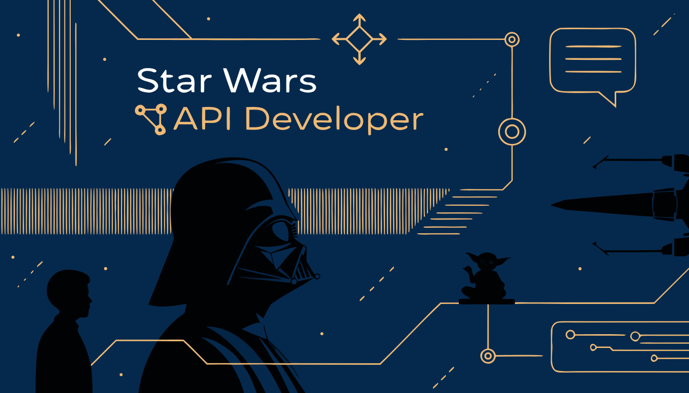

# Star Wars API - Character Fetcher

<p align="center">
  
</p>

Script Node.js interagissant avec l'API [SWAPI](https://swapi-api.hbtn.io/) afin de récupérer et d'afficher les personnages d'un film Star Wars donné en conservant l'ordre exact indiqué par l'endpoint `/films/`.

## Contexte et objectif

Ce projet s'inscrit dans la préparation aux entretiens techniques à **Holberton School** (sujet conçu par **Alexa Orrico**). Il permet de travailler la gestion des requêtes asynchrones, l'intégration d'une API REST et la maîtrise des fermetures lexicales (*closures*) en JavaScript avec Node.js.

## Spécifications et contraintes

* **Environnement** : Ubuntu 14.04 LTS
* **Version de Node.js** : `10.14.x`
* **Linter** : `semistandard` (style Standard JS avec points-virgules obligatoires)
* **Bonnes pratiques** : conformité avec les directives de style AirBnB
* **Exécution** : scripts exécutables (`chmod +x`) débutant par `#!/usr/bin/node` et terminés par une nouvelle ligne

## Installation

1. **Installer Node.js 10.x** :

```bash
curl -sL [https://deb.nodesource.com/setup_10.x](https://deb.nodesource.com/setup_10.x) | sudo -E bash -
sudo apt-get install -y nodejs

```

2. **Installer `semistandard` globalement** :

```bash
sudo npm install semistandard --global

```

3. **Installer le module `request` et configurer `NODE_PATH**` :

```bash
sudo npm install request --global
export NODE_PATH=/usr/lib/node_modules

```

## Structure du dépôt

```text
holbertonschool-interview/
└── starwars_api/
    ├── 0-starwars_characters.js
    └── README.md

```

## Tâche

### 0. Star Wars Characters

* **Fichier** : `0-starwars_characters.js`
* **Utilisation** : `./0-starwars_characters.js <Movie_ID>`
* **Description** : récupère les personnages associés à l'identifiant de film `<Movie_ID>` via l'API SWAPI et affiche leur nom dans l'ordre exact de la liste fournie par le film.

#### Exemple d'exécution

```bash
\$ ./0-starwars_characters.js 3
Luke Skywalker
C-3PO
R2-D2
Darth Vader
Leia Organa
Obi-Wan Kenobi
Chewbacca
Han Solo
Jabba Desilijic Tiure
Wedge Antilles
Yoda
Palpatine
Boba Fett
Lando Calrissian
Ackbar
Mon Mothma
Arvel Crynyd
Wicket Systri Warrick
Nien Nunb
Bib Fortuna

```

#### Vérification du style

```bash
semistandard 0-starwars_characters.js

```

## Auteurs

* **Alexa Orrico** — *Création du projet (Holberton School)*
* **Mathieu** ([Mathieu7483](https://www.google.com/search?q=https://github.com/Mathieu7483)) — *Implémentation*

```
